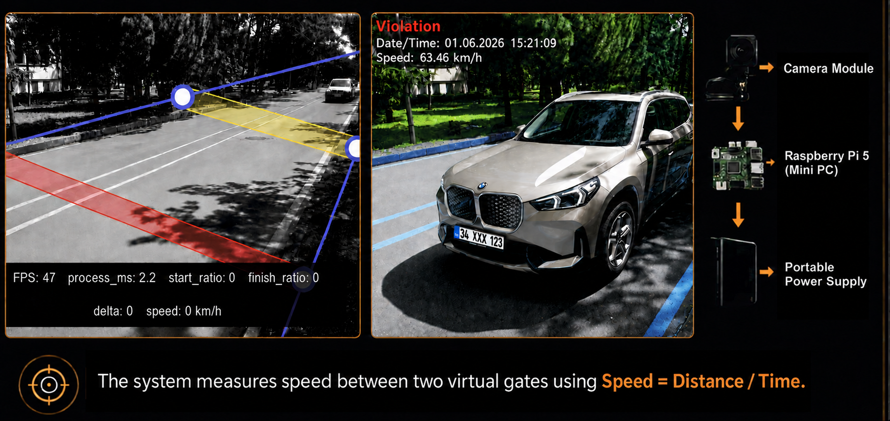

# RadarPi



RadarPi is an offline speed measurement and violation filtering system for
Raspberry Pi 5. It measures travel time between two configurable virtual gates
using pixel changes inside small regions of interest.

The real-time timing loop remains lightweight. Vehicle detection and plate OCR
run only after a violation image has been saved, in a separate low-priority
process. Images without a vehicle are moved to a review directory and never
sent to OCR.

## Features

- Pixel-based START and FINISH gates
- Adaptive background model
- Configurable gate distance and speed limit
- Raspberry Pi Camera Module support through Picamera2
- Browser-based live view and calibration
- Offline YOLOX vehicle validation
- Vehicle-region plate OCR
- Turkish standard plate and six-digit numeric plate validation
- Fail-open behavior when the AI model is unavailable

## Hardware and operating system

- Raspberry Pi 5
- Raspberry Pi OS or Debian-based 64-bit system
- Raspberry Pi camera supported by Picamera2
- Python 3.11 or newer

## Installation

Install system packages:

```bash
sudo apt update
sudo apt install -y git python3-venv python3-opencv python3-numpy \
  python3-flask python3-picamera2 tesseract-ocr tesseract-ocr-eng
```

Clone the repository:

```bash
cd /home/radarpi
git clone https://github.com/muratshimshek/radarpi.git radar
cd /home/radarpi/radar
```

Create a virtual environment that can access the system camera packages:

```bash
python3 -m venv --system-site-packages .venv
source .venv/bin/activate
python -m pip install --upgrade pip
python -m pip install -r requirements_ocr.txt
```

Verify the installation:

```bash
python -m py_compile radar_gate.py vehicle_validation_worker.py plate_reader.py
python test_vehicle_validation.py
```

The test command should finish with `OK`.

## Run manually

```bash
cd /home/radarpi/radar
source .venv/bin/activate
python radar_gate.py
```

Open the web interface from another device on the same network:

```text
http://PI_ADDRESS:5001
```

Use the web interface to position the START and FINISH gates, set the physical
distance between them, select the travel direction, and configure the speed
limit.

## Run as a service

```bash
sudo cp radarpi.service /etc/systemd/system/radarpi.service
sudo systemctl daemon-reload
sudo systemctl enable --now radarpi.service
```

Check status and logs:

```bash
systemctl status radarpi.service --no-pager
journalctl -u radarpi.service -f
```

Do not run another service that uses the same camera or TCP port `5001`.

## Vehicle validation settings

The defaults are defined in `radarpi.service`:

| Variable | Purpose | Default |
| --- | --- | --- |
| `RADAR_AI_MODEL` | YOLOX ONNX model path | `models/yolox_s.onnx` |
| `RADAR_AI_THREADS` | OpenCV worker threads | `2` |
| `RADAR_AI_CONFIDENCE` | Minimum vehicle confidence | `0.25` |
| `RADAR_AI_REJECT_MODE` | No-vehicle action | `move` |
| `RADAR_AI_NICE` | Worker process priority | `10` |
| `RADAR_OCR_SINGLE_MIN_CONFIDENCE` | Single-result OCR threshold | `0.98` |

Keep `RADAR_AI_REJECT_MODE=move` during field testing. No-vehicle images are
moved under `ihlaller/rejected` and receive the `_ARAC_YOK` suffix. After the
filter has been validated in the target environment, `delete` can be selected.

If model loading or inference fails, the original image is preserved.

## Output directories

- Confirmed violation images: `ihlaller/`
- Rejected images: `ihlaller/rejected/`
- Vehicle crops: `violations/vehicle_crops/`
- Validation metadata: `violations/ai_metadata/`
- OCR review data: `violations/ocr_review/`
- Runtime logs: `violations/`

## Privacy

Violation images, rejected frames, OCR crops, debug output, logs, local
configuration, and virtual environments are excluded by `.gitignore`. Never
commit real plates, field recordings, credentials, or device-specific secrets.
